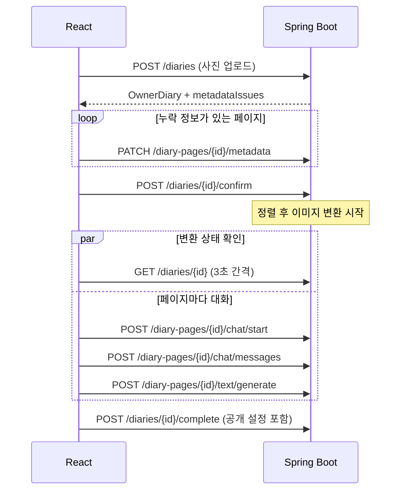

# REST API 명세

프론트엔드(React)와 백엔드(Spring Boot) 사이의 계약이다. 제품 규칙은 [spec.md](spec.md), 저장 구조는 [db-schema.md](db-schema.md)를 따른다.

## 공통 규칙

| 항목 | 규칙 |
|---|---|
| Base URL | `/api/v1` |
| 인증 | `/auth/**`와 `/images/**`를 제외한 모든 API에 `Authorization: Bearer {accessToken}` 필요. `/auth/**`와 `/images/**`는 만료된 토큰이 붙어 있어도 무시한다 |
| 형식 | JSON, 필드명은 camelCase. 업로드만 `multipart/form-data` |
| 날짜 | `2026-11-06` |
| 시간 | `14:30` (요청의 `time` 필드) |
| 시각 | `2026-11-06T14:30:00+09:00` |
| null | 값이 없는 필드는 생략하지 않고 `null`로 내려간다 |
| 이미지 URL | 서버 주소를 포함한 절대 URL. 서명 URL이며 1시간 뒤 만료되므로 저장하지 말고 필요할 때 다시 조회 |
| CORS | `.env`의 `CORS_ALLOWED_ORIGINS`에 등록한 주소만 허용 |

### 페이지네이션

목록 API는 `page`(0부터, 기본 0)와 `size`(기본 20, 1~50)를 받는다. 범위를 벗어나면 `400 VALIDATION_FAILED`다.

```json
{
  "items": [],
  "page": 0,
  "size": 20,
  "totalElements": 42,
  "hasNext": true
}
```

### 오류 응답

```json
{
  "code": "DATE_MISMATCH",
  "message": "다른 날짜의 사진이 있습니다.",
  "details": { "pageIds": [12] }
}
```

`details`는 값이 있을 때만 포함된다. 프론트엔드는 `message`가 아니라 `code`로 분기한다.

| HTTP | code | 상황 |
|---|---|---|
| 400 | `VALIDATION_FAILED` | 필드 값 오류, 필수 파라미터나 파일 누락, 잘못된 enum 값, 읽을 수 없는 JSON |
| 401 | `UNAUTHORIZED` | 토큰 없음, 만료, 위조 |
| 401 | `INVALID_CREDENTIALS` | 이메일 또는 비밀번호 불일치 |
| 401 | `INVALID_GOOGLE_TOKEN` | 구글 ID 토큰 검증 실패 |
| 401 | `INVALID_REFRESH_TOKEN` | 리프레시 토큰이 없거나 만료, 폐기됨 |
| 400 | `INVALID_VERIFICATION_CODE` | 인증 코드가 틀리거나 만료됨, 또는 5회 실패로 무효 |
| 403 | `EMAIL_NOT_VERIFIED` | 비밀번호는 맞지만 이메일 인증을 마치지 않음 |
| 403 | `FORBIDDEN` | 다른 사용자의 일기 수정 시도 |
| 403 | `CANNOT_REPORT_OWN_PAGE` | 자신의 페이지 신고 |
| 404 | `NOT_FOUND` | 대상이 없거나 볼 권한이 없음. 없는 경로나 지원하지 않는 HTTP 메서드도 포함 |
| 409 | `EMAIL_TAKEN` | 이미 인증을 마친 이메일로 가입 시도 |
| 409 | `PAGE_LIMIT_EXCEEDED` | 일기당 4장 초과 (업로드할 때 5장 이상 보낸 경우 포함) |
| 409 | `LAST_PAGE_CANNOT_BE_DELETED` | 마지막 페이지 삭제 시도 |
| 409 | `INVALID_STATE` | 현재 상태에서 할 수 없는 요청 |
| 409 | `CHAT_LIMIT_REACHED` | 800자 도달 후 메시지 전송 |
| 409 | `ALREADY_REPORTED` | 같은 페이지 중복 신고 |
| 409 | `PAGE_REPORT_BLOCKED` | 신고로 차단된 페이지를 공개하려는 시도 |
| 413 | `FILE_TOO_LARGE` | 사진 1장이 10MB 초과, 또는 요청 전체가 41MB 초과 |
| 415 | `UNSUPPORTED_IMAGE_TYPE` | JPEG, PNG, WebP가 아니거나 1억 화소 초과. 확장자가 아니라 파일 내용으로 판별 |
| 422 | `METADATA_INCOMPLETE` | 날짜나 위치 응답이 없는 페이지 존재 |
| 422 | `DATE_MISMATCH` | 페이지들의 논리 날짜가 서로 다름 |
| 422 | `REGION_NOT_SUPPORTED` | 사진 위치가 5개 구 밖임. `message`는 "5개의 구 외에는 아직 불가능합니다" |
| 422 | `PAGE_NOT_SHAREABLE` | 위치 미상인 페이지를 공개하려는 시도 |
| 422 | `DIARY_INCOMPLETE` | 이미지나 글이 없거나 날짜·위치 문제가 남은 페이지가 있는 상태로 저장 |
| 422 | `NO_USER_MESSAGE` | 답변 없이 글 생성 요청 |
| 429 | `TOO_MANY_REQUESTS` | 인증 메일 발송 60초 제한 (재발송, 미인증 이메일 재가입). `details.retryAfterSeconds` 포함 |
| 500 | `INTERNAL_ERROR` | 처리하지 못한 서버 오류 |
| 503 | `AI_UNAVAILABLE` | Gemini 호출 실패(대화, 글 생성). 서버가 503 과부하를 최대 3번 재시도한 뒤에도 실패한 경우. 같은 요청을 다시 보낼 수 있음 |
| 503 | `SEARCH_AI_UNAVAILABLE` | AI 검색 실패(검색어 임베딩). 구를 골라 둘러보도록 안내 |
| 503 | `EMAIL_SEND_FAILED` | 인증 메일 발송 실패. 재발송 API로 다시 시도 |

## 공통 값

| 타입 | 값 |
|---|---|
| Region | `MAPO`(마포구), `JONGNO`(종로구), `JUNG`(중구), `GANGNAM`(강남구), `SEODAEMUN`(서대문구) |
| DiaryStatus | `METADATA_PENDING`, `CREATING`, `COMPLETED` |
| DiaryVisibility | `PRIVATE`, `PUBLIC` |
| PageVisibility | `PRIVATE`, `PHOTO_HIDDEN`, `PUBLIC` |
| DateSource | `EXIF`, `USER_INPUT` |
| LocationSource | `EXIF`, `USER_INPUT`, `UNKNOWN` |
| ImageStatus | `PENDING`, `PROCESSING`, `DONE`, `FAILED` |
| ImageSource | `CONVERTED`, `ORIGINAL` |
| ChatStatus | `NOT_STARTED`, `IN_PROGRESS`, `COMPLETED` |
| ReactionType | `LIKE`, `DISLIKE` |
| ReportReason | `SPAM`, `INAPPROPRIATE`, `PRIVACY`, `OTHER` |
| MetadataIssue | `DATE_REQUIRED`, `LOCATION_REQUIRED`, `DATE_MISMATCH` |

## 공통 응답 객체

### OwnerDiary

작성자 본인에게만 내려가는 일기 전체 데이터다.

```json
{
  "id": 10,
  "status": "CREATING",
  "logicalDate": "2026-11-06",
  "visibility": "PRIVATE",
  "templateId": "default",
  "publishedAt": null,
  "completedAt": null,
  "pages": []
}
```

### OwnerPage

`OwnerDiary.pages`의 항목이다. `sortOrder` 오름차순으로 내려간다.

```json
{
  "id": 12,
  "sortOrder": 0,
  "takenAt": "2026-11-06T14:30:00+09:00",
  "logicalDate": "2026-11-06",
  "dateSource": "EXIF",
  "region": "MAPO",
  "locationSource": "USER_INPUT",
  "originalImageUrl": "https://...",
  "convertedImageUrl": "https://...",
  "imageStatus": "DONE",
  "imageSource": "CONVERTED",
  "imageError": null,
  "chatStatus": "COMPLETED",
  "estimatedChars": 510,
  "content": "오늘은 연남동의 ...",
  "visibility": "PUBLIC",
  "shareable": true,
  "reportBlocked": false,
  "metadataIssues": []
}
```

- `originalImageUrl`: 업로드한 파일 자체가 아니라, 회전을 적용하고 긴 변 2048px 이하로 줄여 EXIF를 지운 JPEG 저장본이다.
- `convertedImageUrl`: 변환 이미지. 원본 저장본과 같은 가로세로 크기의 JPEG다. 변환 전이거나 실패했으면 `null`이다.
- `shareable`: `region`이 있으면 `true`다. `false`면 공개 설정 UI를 막고 이유를 안내한다.
- `metadataIssues`: 입력이 필요한 항목이다. 비어 있어야 다음 단계로 갈 수 있다. `confirm` 전에는 가장 많은 사진의 날짜(같으면 이른 날짜)를 기준으로 `DATE_MISMATCH`를 표시하고, `confirm` 뒤에는 일기의 `logicalDate`를 기준으로 표시한다.
- `imageError`: 변환이 실패했거나 재생성이 실패했을 때의 사유. 정상이면 `null`이다.
- 미리보기와 상세 화면의 이미지는 `imageSource`에 맞는 URL을 쓴다.

### PublicPage

다른 사용자에게 내려가는 페이지다. 대화 내용, 좋아요 수, 싫어요 수는 절대 포함하지 않는다. 원본 URL은 원본 대체 페이지의 `imageUrl`로만 내려간다.

```json
{
  "id": 12,
  "diaryId": 10,
  "sortOrder": 0,
  "region": "MAPO",
  "logicalDate": "2026-11-06",
  "imageUrl": "https://...",
  "imageSource": "CONVERTED",
  "photoHidden": false,
  "content": "오늘은 연남동의 ...",
  "myReaction": "LIKE"
}
```

`PHOTO_HIDDEN`이면 `photoHidden`이 `true`이고 `imageUrl`과 `imageSource`는 `null`이다. `myReaction`은 반응이 없으면 `null`이다.

## 인증

Spring이 직접 JWT를 발급한다. 액세스 토큰은 30분, 리프레시 토큰은 14일 동안 유효하다.

아래 `AuthTokens`는 로그인, 이메일 인증, 구글 로그인, 토큰 재발급의 성공 응답이다. 구글 첫 로그인은 `201`, 나머지는 `200`이다.

```json
{
  "accessToken": "eyJ...",
  "refreshToken": "opaque-random-token",
  "expiresIn": 1800,
  "user": { "id": 1, "email": "user@example.com", "nickname": "서울산책러" }
}
```

### `POST /auth/signup`

```json
{ "email": "user@example.com", "password": "password123", "nickname": "서울산책러", "privacyAgreed": true }
```

계정을 만들고 6자리 인증 코드를 메일로 보낸다. 토큰은 인증을 마친 뒤 발급한다.

- 이메일은 앞뒤 공백을 지우고 소문자로 바꿔 저장한다. 다른 인증 API도 같은 방식으로 비교한다.
- 비밀번호는 8자 이상, 72바이트 이하다. 닉네임은 2~30자이며 앞뒤 공백을 지운다. **닉네임은 다른 사람과 같아도 된다.**
- `privacyAgreed`는 개인정보처리방침 필수 동의다. 없거나 `false`면 `400 VALIDATION_FAILED`다. 동의 시각은 `GET /me`의 `privacyAgreedAt`으로 볼 수 있다.
- **응답:** `201`

```json
{ "email": "user@example.com", "verificationRequired": true, "expiresIn": 600 }
```

- **오류:** `409 EMAIL_TAKEN`, `429 TOO_MANY_REQUESTS`, `503 EMAIL_SEND_FAILED`
- 미인증 이메일로 다시 가입하면 기존 미인증 계정을 새 값으로 덮어쓰고 코드를 다시 보낸다. 마지막 발송 후 60초가 지나지 않았으면 `429`다.
- 메일 발송이 실패해도 계정은 만들어진 상태로 남는다. 60초 뒤 재발송 API로 다시 보낼 수 있다.

### `POST /auth/email/verify`

인증 코드를 확인하고 바로 로그인시킨다.

```json
{ "email": "user@example.com", "code": "123456" }
```

- `code`는 숫자 6자리다. 형식이 다르면 `400 VALIDATION_FAILED`다.
- **응답:** `AuthTokens`
- **오류:** `400 INVALID_VERIFICATION_CODE`. 없는 이메일, 이미 인증한 이메일, 틀린 코드, 10분 만료, 5회 실패를 구분하지 않는다.

### `POST /auth/email/resend`

인증 코드를 다시 보낸다. 이전 코드는 무효가 된다.

```json
{ "email": "user@example.com" }
```

- **응답:** `204`. 가입 여부가 드러나지 않도록 없는 이메일이거나 이미 인증한 이메일이어도 `204`를 반환하고 메일은 보내지 않는다.
- **오류:** `429 TOO_MANY_REQUESTS` (미인증 계정이 있고 60초가 지나지 않은 경우), `503 EMAIL_SEND_FAILED`

### `POST /auth/login`

```json
{ "email": "user@example.com", "password": "password123" }
```

- **응답:** `AuthTokens`
- **오류:** `401 INVALID_CREDENTIALS`, `403 EMAIL_NOT_VERIFIED`. 프론트엔드는 `403`이면 인증 코드 입력 화면으로 이동한다.
- 구글로만 가입한 계정은 비밀번호가 없으므로 `401 INVALID_CREDENTIALS`다.

### `POST /auth/google`

프론트엔드가 Google 로그인으로 받은 ID 토큰을 보낸다. 처음이면 `여행자123456` 형태의 임의 닉네임으로 계정을 만들고 개인정보처리방침 동의를 기록한다(시작 화면의 "계속하면 동의" 안내). 같은 이메일의 계정이 있으면 같은 이메일의 계정이 있으면 구글 계정을 연결한다. 구글 계정을 연결한다. 연결한 계정이 미인증 상태였다면 비밀번호를 지우고 인증된 계정으로 바꾼다.

```json
{ "idToken": "eyJ..." }
```

- 서버는 Google 공개키로 서명, 발급자(`https://accounts.google.com`), 대상(`GOOGLE_CLIENT_ID`)을 검증한다.
- **응답:** `AuthTokens`. 새 계정이면 `201`, 기존 계정이면 `200`
- **오류:** `401 INVALID_GOOGLE_TOKEN` (토큰이 유효하지 않거나, Google이 인증하지 않은 이메일이거나, 서버에 `GOOGLE_CLIENT_ID`가 설정되지 않은 경우)

### `POST /auth/refresh`

```json
{ "refreshToken": "opaque-random-token" }
```

새 토큰 쌍을 발급하고 기존 리프레시 토큰을 폐기한다. 폐기된 토큰을 다시 쓰면 거절한다. **오류:** `401 INVALID_REFRESH_TOKEN`

### `POST /auth/logout`

```json
{ "refreshToken": "opaque-random-token" }
```

리프레시 토큰을 폐기한다. 응답은 `204`이며, 없는 토큰이어도 `204`다. 이미 발급된 액세스 토큰은 만료(최대 30분)까지 유효하므로 프론트엔드에서 지운다.

## 사용자 (마이페이지)

### `GET /me`

프로필(M1)과 개인정보 관리(M4) 화면의 데이터다.

```json
{
  "id": 1,
  "email": "user@example.com",
  "nickname": "서울산책러",
  "profileImageUrl": "https://...",
  "loginMethod": "EMAIL",
  "diaryCount": 3,
  "firstDiaryDate": "2026-10-28",
  "privacyAgreedAt": "2026-10-28T09:00:00+09:00",
  "createdAt": "2026-10-28T09:00:00+09:00"
}
```

| 필드 | 설명 |
|---|---|
| `profileImageUrl` | 프로필 사진 서명 URL. 없으면 `null`(기본 이미지) |
| `loginMethod` | `EMAIL`, `GOOGLE`, `EMAIL_AND_GOOGLE` |
| `diaryCount` | 저장(`COMPLETED`)한 일기 수 ("쓴 일기") |
| `firstDiaryDate` | 저장한 일기 중 가장 이른 논리 날짜 ("처음 쓴 날"). 없으면 `null` |
| `createdAt` | 가입일 |

### `PATCH /me`

```json
{ "nickname": "서울산책러" }
```

닉네임은 2~30자이며 앞뒤 공백을 지운다. 다른 사람과 같아도 된다. 이메일은 바꿀 수 없다. 응답은 `GET /me`와 같다.

### `PUT /me/profile-image`

프로필 사진을 올린다(M2). 자르기는 프론트엔드에서 하고 잘린 이미지를 보낸다.

- **요청:** `multipart/form-data`, `image` 파일 1개. JPEG, PNG, WebP, 10MB 이하
- 서버는 회전을 적용하고 긴 변 512px로 줄여 EXIF를 지운 JPEG로 저장한다. 이전 사진은 지운다.
- **응답:** `GET /me`와 같다. `profileImageUrl`이 새 URL로 바뀐다.
- **오류:** `413 FILE_TOO_LARGE`, `415 UNSUPPORTED_IMAGE_TYPE`

### `DELETE /me/profile-image`

기본 이미지로 되돌린다. 응답은 `GET /me`와 같고 `profileImageUrl`은 `null`이다.

### `GET /me/face-data`

얼굴 데이터 관리(M5) 화면의 데이터다.

```json
{ "registered": true, "registeredAt": "2026-10-28T09:00:00+09:00", "enabled": true, "imageUrl": "https://..." }
```

등록하지 않았으면 `{ "registered": false, "registeredAt": null, "enabled": false, "imageUrl": null }`이다(M5-E). `imageUrl`은 본인에게만 내려가는 서명 URL이다.

### `POST /me/face-data`

얼굴이 잘 보이는 사진 한 장을 등록한다. 이미 있으면 바꾸고 사용을 켠다.

- **요청:** `multipart/form-data`, `image` 파일 1개. JPEG, PNG, WebP, 10MB 이하
- 서버는 긴 변 1024px로 줄여 EXIF를 지운 JPEG로 저장한다.
- **응답:** `201`, `GET /me/face-data`와 같다.
- 사용이 켜져 있으면 이후 그림 변환 때 이 사진을 두 번째 입력 이미지로 보내 주인공을 닮게 그린다. 얼굴 데이터를 읽지 못하면 얼굴 없이 변환한다.

### `PATCH /me/face-data`

그림 변환에 쓸지 켜고 끈다.

```json
{ "enabled": false }
```

- **응답:** `GET /me/face-data`와 같다.
- **오류:** 등록한 얼굴 데이터가 없으면 `404 NOT_FOUND`

### `DELETE /me/face-data`

얼굴 데이터와 파일을 지운다. 이미 저장한 일기의 그림은 그대로 남는다. 응답은 `204`다.

## 이미지

### `GET /images/{imageId}?exp={만료시각}&sig={서명}`

응답 필드의 이미지 URL이 가리키는 주소다. `` 태그에서 쓸 수 있도록 Bearer 토큰 대신 서버가 HMAC으로 서명한 URL을 사용한다. 프론트엔드가 직접 조합하지 않는다.

- **응답:** 이미지 바이트. `Content-Type`은 저장된 형식(현재는 모두 `image/jpeg`), `Cache-Control: private, max-age=300`
- **오류:** 서명이 틀리거나 만료되면 `401 UNAUTHORIZED`, 이미지가 삭제되었으면 `404 NOT_FOUND`, `exp`나 `sig`가 없으면 `400 VALIDATION_FAILED`
- 서명만 확인하므로, 공개 범위를 바꾸기 전에 발급된 URL은 만료될 때까지 열린다.

### `GET /images/users/{userId}/{kind}?v={버전}&exp={만료시각}&sig={서명}`

프로필 사진(`kind=profile`)과 얼굴 데이터(`kind=face`)의 서명 URL이다. 프론트엔드가 직접 조합하지 않는다.

- 사진을 바꾸면 `v`가 달라져 URL도 바뀐다.
- 얼굴 데이터 URL은 본인의 `GET /me/face-data`에서만 내려준다.
- **오류:** 서명이 틀리거나 만료되면 `401 UNAUTHORIZED`, 사진이 지워졌으면 `404 NOT_FOUND`

## 일기 만들기

### 전체 호출 순서



### `POST /diaries`

사진을 올려 초안을 만든다. 서버가 EXIF에서 촬영 시각(`DateTimeOriginal`, 한국 시간으로 간주)과 GPS를 읽는다. 사진은 회전을 적용하고 긴 변 2048px 이하로 줄여 EXIF를 지운 JPEG로 저장한다. GPS 좌표는 구를 판정한 뒤 버린다.

- **요청:** `multipart/form-data`, `photos` 파일 1~4개. 같은 이름으로 여러 번 넣는다
- **제한:** JPEG, PNG, WebP. 장당 10MB
- **응답:** `201`, `OwnerDiary` (`status: METADATA_PENDING`). 페이지 순서는 업로드 순서다
- **오류:**
  - `400 VALIDATION_FAILED`: 사진이 0장
  - `409 PAGE_LIMIT_EXCEEDED`: 사진이 5장 이상
  - `413`, `415`: 파일 크기나 형식 오류
  - `422 REGION_NOT_SUPPORTED`: 한 장이라도 EXIF 위치가 5개 구 밖이면 초안을 만들지 않는다. `details.fileIndexes`로 문제 사진의 순서(0부터)를 전달한다
- GPS가 있어도 네이버 위치 판정이 실패하면 거절하지 않고 `LOCATION_REQUIRED`로 남긴다.

### `GET /diaries/{diaryId}`

내 일기를 조회한다. 상태와 관계없이 조회할 수 있고, 변환 상태 폴링과 미리보기에도 쓴다. 응답은 `OwnerDiary`다. 다른 사용자의 일기면 `404 NOT_FOUND`다.

폴링은 모든 페이지의 `imageStatus`가 `DONE` 또는 `FAILED`가 되면 멈춘다. 변환은 사진 한 장에 수십 초가 걸릴 수 있다.

### `PATCH /diary-pages/{pageId}/metadata`

누락 정보를 입력한다. 보낸 필드만 바꾼다. `METADATA_PENDING`과 `CREATING` 상태에서 사용할 수 있다.

```json
{
  "date": "2026-11-06",
  "time": "14:30",
  "location": { "district": "마포구" }
}
```

**모르겠습니다**를 누른 경우:

```json
{ "location": { "unknown": true } }
```

- `date`만 보내면 입력한 날짜를 논리 날짜로 쓰고, 촬영 시각(`takenAt`)은 `null`이 된다.
- `time`을 함께 보내면 5시간 규칙을 적용해 논리 날짜를 계산한다. 11월 7일 `03:00`은 11월 6일이다.
- `time`만 보내면 이미 있는 날짜에 붙인다. 날짜가 없으면 `400 VALIDATION_FAILED`다.
- 날짜나 시간을 보내면 `dateSource`는 `USER_INPUT`이 된다.
- `location`에는 `district`와 `unknown: true` 중 하나만 넣는다. 둘 다 넣거나 둘 다 없으면 `400 VALIDATION_FAILED`다.
- `district`는 앞뒤 공백을 지운 뒤 `마포구`, `종로구`, `중구`, `강남구`, `서대문구`와 정확히 비교한다. `마포`, `서대문`처럼 줄인 이름도 거절한다. 네이버 API는 호출하지 않는다.
- 위치를 모른다고 응답하면 `visibility`는 `PRIVATE`으로 고정되고 `shareable`은 `false`가 된다.
- `CREATING` 상태에서 입력이 완전해지고 날짜가 일기와 같아지면, 아직 변환 전인 페이지는 변환을 자동으로 시작한다.
- **응답:** `OwnerPage`
- **오류:** `422 REGION_NOT_SUPPORTED` (`district`가 5개 구 이름이 아니면 거절하고 입력창을 유지), `409 INVALID_STATE` (`COMPLETED`), `403 FORBIDDEN`

### `POST /diaries/{diaryId}/pages`

업로드 단계에서 사진을 추가한다. `METADATA_PENDING`에서만 가능하다.

- **요청:** `multipart/form-data`, `photo` 파일 1개
- **응답:** `201`, `OwnerPage`. 마지막 순서로 추가된다
- **오류:** `409 PAGE_LIMIT_EXCEEDED`, `409 INVALID_STATE` (`METADATA_PENDING`이 아님), `422 REGION_NOT_SUPPORTED`

### `PUT /diary-pages/{pageId}/photo`

사진을 교체한다. 해당 페이지의 메타데이터, 이미지, 대화, 글을 초기화한다. `COMPLETED` 전까지 가능하다.

- **요청:** `multipart/form-data`, `photo` 파일 1개
- **응답:** `OwnerPage`. 공개 범위도 `PRIVATE`으로 돌아간다
- **오류:** `422 REGION_NOT_SUPPORTED` (이 경우 기존 사진과 내용을 유지), `409 INVALID_STATE` (`COMPLETED`)
- `CREATING` 상태에서는 메타데이터가 완전하고 날짜가 일기와 같아지는 시점에 변환을 자동으로 시작한다. 날짜가 다르면 `metadataIssues`에 `DATE_MISMATCH`가 나타난다.
- 교체 전 사진의 변환이 진행 중이었다면 그 결과는 버린다.

### `DELETE /diary-pages/{pageId}`

페이지를 삭제한다. `COMPLETED` 전까지 가능하며, 저장한 뒤에는 `409 INVALID_STATE`다. 응답은 `204`다.

마지막 남은 페이지를 지우면 `409 LAST_PAGE_CANNOT_BE_DELETED`를 반환한다. 전부 버리려면 일기 삭제를 사용한다.

### `POST /diaries/{diaryId}/confirm`

사진 정보를 확정한다. 서버는 페이지를 시간순으로 정렬하고, 논리 날짜를 정하고, 이미지 변환을 시작한다.

- 정렬 순서: 촬영 시각이 있는 페이지를 시간순으로 두고, 시각이 없는 페이지는 그 뒤에 업로드 순서대로 둔다. `sortOrder`가 0부터 다시 매겨진다.
- **요청:** 본문 없음
- **응답:** `OwnerDiary` (`status: CREATING`). 변환이 바로 끝나지 않으므로 `imageStatus`는 보통 `PENDING`이나 `PROCESSING`이다
- **오류:**
  - `422 METADATA_INCOMPLETE`: 날짜나 위치 응답이 없는 페이지가 있음
  - `422 DATE_MISMATCH`: 가장 많은 사진의 날짜(같으면 이른 날짜)와 다른 페이지가 있음
  - 두 오류 모두 `details.pageIds`로 문제 페이지를 전달한다
  - `409 INVALID_STATE`: 이미 확정된 일기

## 이미지 변환

변환은 `confirm` 이후 백그라운드에서 진행하며, 서버가 자동으로 1회 재시도한다. 재시도까지 실패하면 `imageStatus`가 `FAILED`가 된다.

변환은 Cloudflare Workers AI의 FLUX.2 [klein] 4B가 처리한다. 결과는 원본 저장본과 같은 가로세로 크기의 JPEG로 저장된다. 서버가 재시작되면 진행 중이던 변환은 다시 처리된다.

프론트엔드는 `FAILED`를 받으면 문제 사진을 보여 주고 사용자가 고르게 한다.

| 선택 | 호출 |
|---|---|
| 사진 교체 | `PUT /diary-pages/{pageId}/photo` |
| 원본으로 넣기 | `POST /diary-pages/{pageId}/image/use-original` |
| 다시 시도 | `POST /diary-pages/{pageId}/image/regenerate` |

### `POST /diary-pages/{pageId}/image/regenerate`

이미지를 다시 만든다. 실패한 경우와 미리보기에서 마음에 들지 않는 경우에 쓴다. `CREATING`에서 `imageStatus`가 `DONE` 또는 `FAILED`일 때만 가능하다. 변환 중(`PENDING`, `PROCESSING`)이면 `409 INVALID_STATE`다.

- **응답:** `202`, `OwnerPage` (`imageStatus`는 `PENDING` 또는 `PROCESSING`)
- 원본 사용 상태였던 페이지도 재생성에 성공하면 `imageSource`가 `CONVERTED`로 바뀐다.
- 새 이미지를 만드는 동안과 실패한 뒤에도 기존 `convertedImageUrl`은 유지한다.
- 표시 중인 이미지가 있는 페이지의 재생성이 실패하면 `imageStatus`는 `DONE`으로 돌아오고 `imageError`에 사유가 담긴다. 표시할 이미지가 없을 때만 `FAILED`가 된다.

### `POST /diary-pages/{pageId}/image/use-original`

원본을 페이지 이미지로 사용한다. `CREATING`에서 `imageStatus`가 `FAILED`일 때만 가능하며, 그 외에는 `409 INVALID_STATE`다.

- **응답:** `OwnerPage` (`imageStatus: DONE`, `imageSource: ORIGINAL`)
- 원본을 사용한 페이지를 공개하면 다른 사용자에게 원본 저장본(EXIF 제거본)이 보인다. `PHOTO_HIDDEN`으로 두면 글만 보인다.

## 챗봇과 일기 글

대화는 페이지별로 진행한다. 아래 조건을 모두 만족해야 하며, 아니면 `409 INVALID_STATE`다.

- 일기가 `CREATING` 상태다.
- 페이지의 날짜와 위치 입력이 끝났고, 날짜가 일기와 같다.

AI 응답은 스트리밍 없이 한 번에 받으며 수 초가 걸릴 수 있다. AI는 원본 저장본을 보고 질문한다. 변환이 끝나기를 기다리지 않아도 된다.

### `POST /diary-pages/{pageId}/chat/start`

사진을 분석해 첫 질문을 만든다. 이미 시작했으면 AI를 다시 부르지 않고 기존 첫 질문을 돌려준다.

- **오류:** `409 INVALID_STATE`, `503 AI_UNAVAILABLE`

```json
{
  "message": {
    "id": 100,
    "role": "ASSISTANT",
    "content": "카페에서 책을 읽으신 것 같아요. 어떤 책이었나요?",
    "createdAt": "2026-11-06T14:30:00+09:00"
  },
  "chatStatus": "IN_PROGRESS",
  "estimatedChars": 0,
  "finishSuggested": false,
  "limitReached": false
}
```

### `GET /diary-pages/{pageId}/chat/messages`

대화 기록을 오래된 순으로 조회한다. 일기 상태와 관계없이 조회할 수 있다.

```json
{
  "items": [
    { "id": 100, "role": "ASSISTANT", "content": "...", "createdAt": "2026-11-06T14:30:00+09:00" },
    { "id": 101, "role": "USER", "content": "...", "createdAt": "2026-11-06T14:31:00+09:00" }
  ],
  "chatStatus": "IN_PROGRESS",
  "estimatedChars": 120,
  "finishSuggested": false,
  "limitReached": false
}
```

### `POST /diary-pages/{pageId}/chat/messages`

답변을 보내고 다음 질문을 받는다.

```json
{ "content": "소설을 읽었는데 분위기가 정말 좋았어요." }
```

`content`는 1~500자다. 응답 형식은 `chat/start`와 같다.

| 필드 | 조건 | 프론트엔드 동작 |
|---|---|---|
| `finishSuggested` | `estimatedChars >= 500` | 마무리 안내 표시, 대화 계속 가능 |
| `limitReached` | `estimatedChars >= 800` | 입력을 막고 글 생성 유도 |

- `estimatedChars`는 AI가 추정한 일기 분량이며 대화 중에 줄어들지 않고, 800을 넘지 않는다.
- AI 호출이 성공한 뒤에만 사용자 답변과 다음 질문을 함께 저장한다. `503 AI_UNAVAILABLE`이면 답변이 저장되지 않았으므로 같은 내용을 다시 보내면 된다.
- **오류:** `409 CHAT_LIMIT_REACHED` (800자 도달 후 전송), `409 INVALID_STATE` (`chat/start` 전이거나 글 생성 후), `503 AI_UNAVAILABLE`

### `POST /diary-pages/{pageId}/text/generate`

대화로 일기 글을 만든다. 500자를 목표로 하고 800자를 넘지 않는다. AI가 800자를 넘기면 800자 안의 마지막 문장까지만 남긴다. 다시 호출하면 같은 대화로 글을 다시 만들어 기존 글을 덮어쓴다.

- **요청:** 본문 없음
- **응답:** `OwnerPage` (`chatStatus: COMPLETED`, `content` 채워짐)
- **오류:** `422 NO_USER_MESSAGE`, `409 INVALID_STATE`, `503 AI_UNAVAILABLE`
- 글을 만든 뒤에는 대화를 이어 갈 수 없다. 메시지를 보내면 `409 INVALID_STATE`를 반환한다. 내용은 직접 수정할 수 있다.

## 미리보기와 저장

### `POST /diaries/{diaryId}/complete`

페이지별 공개 설정과 함께 일기를 저장한다.

```json
{
  "visibility": "PUBLIC",
  "templateId": "default",
  "pages": [
    { "id": 12, "content": "수정한 글", "visibility": "PUBLIC" },
    { "id": 13, "visibility": "PHOTO_HIDDEN" },
    { "id": 14, "visibility": "PRIVATE" }
  ]
}
```

- `visibility`는 필수다. `templateId`(1~50자)와 `pages`(최대 4개)는 생략할 수 있다.
- `pages`에 넣지 않은 페이지는 값을 그대로 유지한다. `content`는 생략할 수 있고 1~800자여야 한다.
- 일기에 없는 페이지 `id`를 넣으면 `400 VALIDATION_FAILED`다.
- 모든 페이지에 이미지(`DONE`)와 글이 있고, 날짜·위치 문제가 없어야 한다.
- 일기를 처음 `PUBLIC`으로 저장할 때 `publishedAt`이 기록된다.
- **응답:** `OwnerDiary` (`status: COMPLETED`)
- **오류:** `422 DIARY_INCOMPLETE`, `422 PAGE_NOT_SHAREABLE` (`details.pageIds`로 문제 페이지 전달), `409 INVALID_STATE` (`CREATING`이 아님)
- 공개한 페이지는 바로 커뮤니티에 보이지만, AI 검색에는 임베딩이 만들어진 뒤(최대 약 1분)부터 나타난다.

## 마이페이지

### `GET /me/diaries?page=0&size=20`

저장(`COMPLETED`)한 일기만 논리 날짜 최신순으로 조회한다. 같은 날짜는 저장 시각 최신순이다. 작성 중인 초안은 나오지 않는다.

- `thumbnailUrl`: 첫 페이지의 표시 이미지(변환 이미지 또는 원본 사용 시 원본)
- `preview`: 첫 페이지 글의 앞 100자. 더 길면 끝에 `...`가 붙는다

```json
{
  "items": [
    {
      "id": 10,
      "logicalDate": "2026-11-06",
      "visibility": "PUBLIC",
      "pageCount": 3,
      "regions": ["MAPO", "JONGNO"],
      "thumbnailUrl": "https://...",
      "preview": "오늘은 연남동의 ...",
      "completedAt": "2026-11-06T20:00:00+09:00"
    }
  ],
  "page": 0,
  "size": 20,
  "totalElements": 1,
  "hasNext": false
}
```

- `regions`: 일기의 페이지에 있는 구를 페이지 순서대로 중복 없이 담는다. 홈과 내 일기 목록의 "11.4 · 마포구" 표시에 쓴다. 위치를 모르는 페이지만 있으면 빈 배열이다.
- 홈(H1, H2)도 이 API를 쓴다. 쓴 일기 수는 `totalElements`, 지난 일기는 첫 항목이다.

상세는 `GET /diaries/{diaryId}`를 사용한다.

### `PATCH /diaries/{diaryId}`

저장된 일기의 공개 범위나 템플릿을 바꾼다. 공개 범위 변경 화면(N3)처럼 **일기와 페이지 공개 범위를 한 번에** 저장할 수 있다. 보낸 필드만 바꾼다. `COMPLETED`가 아니면 `409 INVALID_STATE`를 반환한다. 처음 `PUBLIC`으로 바꿀 때 `publishedAt`이 기록되고, 이후에는 바뀌지 않는다.

```json
{
  "visibility": "PUBLIC",
  "templateId": "default",
  "pages": [
    { "id": 12, "visibility": "PUBLIC" },
    { "id": 13, "visibility": "PHOTO_HIDDEN" }
  ]
}
```

- `pages`는 선택이며 최대 4개다. 넣지 않은 페이지는 그대로 둔다. 일기에 없는 페이지 `id`면 `400 VALIDATION_FAILED`다.
- 하나라도 바꿀 수 없는 페이지가 있으면 아무것도 바꾸지 않는다.
- **응답:** `OwnerDiary`
- **오류:** `422 PAGE_NOT_SHAREABLE` (`details.pageIds`), `409 PAGE_REPORT_BLOCKED`

### `PATCH /diary-pages/{pageId}`

페이지의 글이나 공개 범위를 바꾼다. 보낸 필드만 바꾼다. `CREATING`과 `COMPLETED`에서 가능하며, `METADATA_PENDING`이면 `409 INVALID_STATE`다.

```json
{ "content": "수정한 글", "visibility": "PHOTO_HIDDEN" }
```

- `content`는 1~800자다.
- 공개된 페이지의 글을 고치면 검색 인덱스가 바로 지워지고, 새 글로 다시 만들어질 때까지(최대 약 1분) 검색에 나오지 않는다. 커뮤니티 화면에는 바로 반영된다.
- **응답:** `OwnerPage`
- **오류:** `422 PAGE_NOT_SHAREABLE`, `409 PAGE_REPORT_BLOCKED` (차단된 페이지를 `PRIVATE` 외의 값으로 바꾸려는 경우)

### `DELETE /diaries/{diaryId}`

일기와 페이지, 대화, 반응, 신고, 이미지 파일을 모두 삭제한다. 작성 중인 초안도 삭제할 수 있다. 응답은 `204`다. 다른 사용자의 일기면 `403 FORBIDDEN`이다.

## 커뮤니티

모든 커뮤니티 API는 [공개 조건](spec.md#공개-규칙)을 만족하는 페이지만 내려준다.

### `GET /community/diaries?region=MAPO&page=0&size=20`

공개 일기를 조회한다. 자신의 일기도 포함된다. `region`을 주면 그 지역 페이지가 있는 일기만, 그 지역 페이지만 포함한다. `region`을 생략하면 모든 공개 페이지를 포함한다. `region`에 5개 구 외의 값을 보내면 `400 VALIDATION_FAILED`다.

표시되는 페이지의 `좋아요 수 - 싫어요 수` 합이 큰 일기부터 내려준다. 합이 같으면 최신 공개순이다. 한 일기의 `pages`는 `sortOrder` 오름차순이다. 점수는 응답에 포함하지 않는다.

```json
{
  "items": [
    {
      "diaryId": 10,
      "author": { "nickname": "서울산책러", "profileImageUrl": null },
      "logicalDate": "2026-11-06",
      "publishedAt": "2026-11-06T20:00:00+09:00",
      "pages": []
    }
  ],
  "page": 0,
  "size": 20,
  "totalElements": 1,
  "hasNext": false
}
```

`pages`는 `PublicPage` 배열이다. `author.profileImageUrl`은 작성자의 프로필 사진 서명 URL이며 없으면 `null`이다. 닉네임은 중복될 수 있으므로 작성자를 구분할 때 닉네임을 쓰지 않는다.

### `GET /community/diaries/{diaryId}?region=MAPO`

공개 일기의 상세를 조회한다. 목록과 같은 필터를 적용해, 선택한 지역 페이지만 내려준다. 응답은 목록의 항목 하나와 같다.

보여 줄 페이지가 없으면 `404 NOT_FOUND`를 반환한다.

### `GET /community/search?q={text}&region=MAPO&limit=20`

의미가 비슷한 공개 페이지를 찾는다. 유사도 기준(`.env`의 `SEARCH_MIN_SIMILARITY`)을 넘는 페이지를 유사도가 높은 순으로만 내려주며, 좋아요와 싫어요는 순서에 영향을 주지 않는다. 유사도 값은 응답에 포함하지 않는다.

- `q`: 1~200자, 필수
- `region`: 선택. 5개 구만 허용
- `limit`: 기본 20, 1~50
- 검색어마다 Gemini 임베딩을 호출하므로 실패하면 `503 SEARCH_AI_UNAVAILABLE`이다.
- 서버가 공개 페이지의 글로 임베딩을 1분마다 만든다. 새로 공개하거나 고친 글은 최대 약 1분 뒤부터 검색된다.

```json
{
  "items": [
    {
      "author": { "nickname": "서울산책러", "profileImageUrl": null },
      "page": {}
    }
  ]
}
```

`page`는 `PublicPage`다. 기준을 넘는 결과가 없으면 `items`가 빈 배열이며, 프론트엔드는 "비슷한 일기가 없어요"를 보여 준다. 이 경우 응답 코드는 `200`이다.

## 반응과 신고

아래 API의 대상은 공개 페이지다. 그 외에는 `404 NOT_FOUND`를 반환한다.

### `PUT /community/pages/{pageId}/reaction`

반응을 설정한다. 다른 반응이 있으면 교체한다. 자신의 페이지에도 할 수 있다.

```json
{ "type": "LIKE" }
```

```json
{ "myReaction": "LIKE" }
```

좋아요 수와 싫어요 수는 내려주지 않는다.

### `DELETE /community/pages/{pageId}/reaction`

반응을 취소한다. 응답 형식은 `PUT`과 같고 값은 `{ "myReaction": null }`이다. 반응이 없었어도 같은 응답이다.

### `POST /community/pages/{pageId}/reports`

페이지를 신고한다.

```json
{ "reason": "PRIVACY", "detail": "개인정보가 포함되어 있습니다." }
```

- `detail`은 선택이며 500자 이하다.
- **응답:** `201`, 본문 없음
- **오류:** `403 CANNOT_REPORT_OWN_PAGE`, `409 ALREADY_REPORTED`
- 3번째 신고가 접수되면 해당 페이지만 즉시 차단한다. 작성자의 `OwnerPage.reportBlocked`가 `true`가 된다.
- 차단된 페이지는 커뮤니티, 검색, 반응, 신고 대상에서 모두 빠진다. 작성자는 마이페이지에서 계속 볼 수 있지만 다시 공개할 수 없고, 해제하는 API는 없다.

## 화면과 API 대응

화면 ID는 프론트엔드 화면 보드(`scrapbook-ui-v3.html`)의 것이다. `-D`가 붙은 데스크톱 화면은 같은 ID의 모바일 화면과 같은 API를 쓴다.

| 화면 | API |
|---|---|
| A1 시작 | `POST /auth/google` |
| A2 회원가입, A2-E 가입 오류 | `POST /auth/signup` (`privacyAgreed` 필수, `409 EMAIL_TAKEN`) |
| A3 이메일 인증, A3-E 코드 오류 | `POST /auth/email/verify`, `POST /auth/email/resend` (남은 시간은 `expiresIn`, 재발송 대기는 `429`의 `retryAfterSeconds`) |
| A4 로그인, A4-E 로그인 오류 | `POST /auth/login`, `POST /auth/google` |
| A5 개인정보처리방침 | 없음 (화면 고정 문구) |
| H1 첫 사용, H2 일기 있음 | `GET /me/diaries` (`totalElements`, 첫 항목의 `logicalDate`·`regions`·`preview`·`thumbnailUrl`) |
| C1 사진 업로드, C1-1 사진 선택됨, C1-E 지역 밖 사진 | `POST /diaries`, `POST /diaries/{id}/pages`, `DELETE /diary-pages/{id}` |
| C2 위치 입력, C2-E 위치 거절, C2-U 모르겠습니다, C3 날짜 입력 | `PATCH /diary-pages/{id}/metadata` |
| C4 날짜 불일치 | `POST /diaries/{id}/confirm` (`422 DATE_MISMATCH`), `PATCH .../metadata`, `PUT /diary-pages/{id}/photo` |
| C5 페이지 현황 | `GET /diaries/{id}` (페이지별 `chatStatus`, `imageStatus`) |
| C5-F 변환 실패 선택 | `PUT /diary-pages/{id}/photo`, `POST .../image/use-original`, `POST .../image/regenerate` |
| C6 대화, C6-1 마무리 안내, C6-2 입력 마감 | `POST .../chat/start`, `GET`/`POST .../chat/messages` (`estimatedChars`, `finishSuggested`, `limitReached`) |
| C7 글 생성 중 | `POST /diary-pages/{id}/text/generate` |
| C8 미리보기, C8-E 재생성 실패 | `GET /diaries/{id}`, `POST .../image/regenerate` (실패 시 `imageError`) |
| C9 글 수정 | `PATCH /diary-pages/{id}` (`content`) |
| C10 공개 설정 | `POST /diaries/{id}/complete` |
| S1 구 고르기, S2 구별 일기 목록 | `GET /community/diaries?region=` |
| S3 일기 상세 | `GET /community/diaries/{id}?region=`, `PUT`/`DELETE /community/pages/{id}/reaction` |
| S4 AI 검색 결과, S4-E 검색 결과 없음 | `GET /community/search` (실패 시 `503 SEARCH_AI_UNAVAILABLE`) |
| S5 신고 | `POST /community/pages/{id}/reports` |
| N1 내 일기 | `GET /me/diaries` |
| N2 일기 상세, N2-B 차단된 페이지 | `GET /diaries/{id}` (`reportBlocked`) |
| N3 공개 범위 변경 | `PATCH /diaries/{id}` (`visibility`와 `pages`를 한 번에) |
| N4 일기 삭제 확인 | `DELETE /diaries/{id}` |
| M1 프로필 | `GET /me` |
| M2 프로필 수정, M2-1 사진 자르기 | `PATCH /me`, `PUT`/`DELETE /me/profile-image` |
| M3 설정, M3-1 로그아웃 확인 | `POST /auth/logout` |
| M4 개인정보 관리 | `GET /me` (`loginMethod`, `createdAt`) |
| M5 얼굴 데이터 관리, M5-1 삭제 확인, M5-E 없음 | `GET`/`PATCH`/`DELETE /me/face-data` |
| (화면 없음) 얼굴 데이터 등록 | `POST /me/face-data` |
| 09 오류 안내 | 각 API의 `code` |
