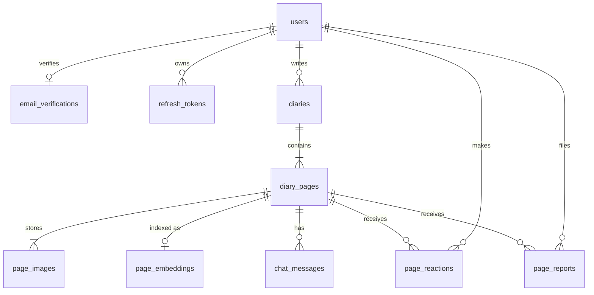

# DB 스키마

규칙의 근거는 [spec.md](spec.md), API 필드와의 대응은 [api-spec.md](api-spec.md)를 따른다.

- 서비스 데이터는 **MySQL 8.0.16 이상**에 저장한다. `CHECK` 제약을 쓰므로 이 버전 이상이 필요하다.
- 이미지 파일은 DB 밖의 이미지 저장소에 두고, DB에는 상대 경로만 저장한다.
- 시각은 한국 시간 기준으로 저장한다. JDBC 연결의 시간대를 `Asia/Seoul`로 고정한다.

## ER 다이어그램



## DDL

```sql
CREATE TABLE users (
  id             BIGINT        NOT NULL AUTO_INCREMENT,
  email          VARCHAR(255)  NOT NULL,
  email_verified_at DATETIME   NULL COMMENT 'NULL이면 미인증. 구글 로그인은 가입 시 설정',
  password_hash  VARCHAR(100)  NULL COMMENT 'BCrypt. 구글 전용 계정은 NULL',
  google_sub     VARCHAR(255)  NULL COMMENT 'Google ID 토큰의 sub',
  nickname       VARCHAR(30)   NOT NULL COMMENT '중복 허용',
  privacy_agreed_at DATETIME   NULL COMMENT '개인정보처리방침 동의 시각',
  profile_image_path VARCHAR(255) NULL COMMENT '프로필 사진 상대 경로',
  profile_image_version INT    NOT NULL DEFAULT 0 COMMENT '바뀔 때마다 증가. URL 캐시 구분용',
  face_image_path VARCHAR(255) NULL COMMENT '등록한 얼굴 사진 상대 경로',
  face_registered_at DATETIME  NULL,
  face_enabled   BOOLEAN       NOT NULL DEFAULT TRUE COMMENT '그림 변환에 얼굴 데이터를 쓸지',
  created_at     DATETIME      NOT NULL DEFAULT CURRENT_TIMESTAMP,
  updated_at     DATETIME      NOT NULL DEFAULT CURRENT_TIMESTAMP ON UPDATE CURRENT_TIMESTAMP,
  PRIMARY KEY (id),
  UNIQUE KEY uk_users_email (email),
  UNIQUE KEY uk_users_google_sub (google_sub),
  CONSTRAINT ck_users_login_method CHECK (password_hash IS NOT NULL OR google_sub IS NOT NULL)
) ENGINE=InnoDB DEFAULT CHARSET=utf8mb4 COLLATE=utf8mb4_0900_ai_ci;


-- 사용자당 유효한 코드는 하나다. 재발송하면 행을 덮어쓰고, 인증에 성공하면 행을 지운다
CREATE TABLE email_verifications (
  user_id       BIGINT    NOT NULL,
  code_hash     CHAR(64)  NOT NULL COMMENT '코드 원문이 아닌 HMAC-SHA256 해시',
  expires_at    DATETIME  NOT NULL COMMENT '발송 후 10분',
  attempts      TINYINT   NOT NULL DEFAULT 0 COMMENT '5회 실패하면 코드 무효',
  last_sent_at  DATETIME  NOT NULL COMMENT '재발송 60초 제한 기준',
  PRIMARY KEY (user_id),
  CONSTRAINT fk_email_verifications_user FOREIGN KEY (user_id) REFERENCES users (id) ON DELETE CASCADE
) ENGINE=InnoDB DEFAULT CHARSET=utf8mb4 COLLATE=utf8mb4_0900_ai_ci;


CREATE TABLE refresh_tokens (
  id          BIGINT    NOT NULL AUTO_INCREMENT,
  user_id     BIGINT    NOT NULL,
  token_hash  CHAR(64)  NOT NULL COMMENT '토큰 원문이 아닌 SHA-256 해시',
  expires_at  DATETIME  NOT NULL,
  revoked_at  DATETIME  NULL,
  created_at  DATETIME  NOT NULL DEFAULT CURRENT_TIMESTAMP,
  PRIMARY KEY (id),
  UNIQUE KEY uk_refresh_token_hash (token_hash),
  KEY idx_refresh_user (user_id),
  CONSTRAINT fk_refresh_user FOREIGN KEY (user_id) REFERENCES users (id) ON DELETE CASCADE
) ENGINE=InnoDB DEFAULT CHARSET=utf8mb4 COLLATE=utf8mb4_0900_ai_ci;


CREATE TABLE diaries (
  id            BIGINT       NOT NULL AUTO_INCREMENT,
  user_id       BIGINT       NOT NULL,
  logical_date  DATE         NULL COMMENT '확정(confirm) 시 설정',
  status        VARCHAR(20)  NOT NULL DEFAULT 'METADATA_PENDING',
  visibility    VARCHAR(10)  NOT NULL DEFAULT 'PRIVATE',
  template_id   VARCHAR(50)  NOT NULL DEFAULT 'default' COMMENT '프론트엔드 템플릿 식별자',
  published_at  DATETIME     NULL COMMENT '처음 공개한 시각. 점수가 같을 때의 정렬 기준',
  completed_at  DATETIME     NULL,
  created_at    DATETIME     NOT NULL DEFAULT CURRENT_TIMESTAMP,
  updated_at    DATETIME     NOT NULL DEFAULT CURRENT_TIMESTAMP ON UPDATE CURRENT_TIMESTAMP,
  PRIMARY KEY (id),
  KEY idx_diaries_owner_list (user_id, status, logical_date),
  KEY idx_diaries_feed (status, visibility, published_at),
  CONSTRAINT fk_diaries_user FOREIGN KEY (user_id) REFERENCES users (id) ON DELETE CASCADE,
  CONSTRAINT ck_diaries_status CHECK (status IN ('METADATA_PENDING', 'CREATING', 'COMPLETED')),
  CONSTRAINT ck_diaries_visibility CHECK (visibility IN ('PRIVATE', 'PUBLIC'))
) ENGINE=InnoDB DEFAULT CHARSET=utf8mb4 COLLATE=utf8mb4_0900_ai_ci;


CREATE TABLE diary_pages (
  id                BIGINT        NOT NULL AUTO_INCREMENT,
  diary_id          BIGINT        NOT NULL,
  sort_order        TINYINT       NOT NULL COMMENT '업로드 순서로 시작해 확정 시 시간순으로 재배치',

  -- 날짜와 시간
  taken_at          DATETIME      NULL COMMENT '시간을 모르면 NULL',
  logical_date      DATE          NULL COMMENT 'taken_at - 5시간의 날짜 또는 사용자 입력 날짜',
  date_source       VARCHAR(10)   NULL COMMENT 'NULL이면 입력 대기',

  -- 위치
  region            VARCHAR(10)   NULL COMMENT '모르겠습니다를 고르면 NULL',
  location_source   VARCHAR(10)   NULL COMMENT 'NULL이면 입력 대기',

  -- 이미지 상태 (파일은 page_images)
  image_status      VARCHAR(12)   NOT NULL DEFAULT 'PENDING',
  image_source      VARCHAR(10)   NULL COMMENT '페이지에 표시할 이미지 종류',
  image_attempts    TINYINT       NOT NULL DEFAULT 0,
  image_error       VARCHAR(255)  NULL,

  -- 대화와 글
  chat_status       VARCHAR(12)   NOT NULL DEFAULT 'NOT_STARTED',
  estimated_chars   SMALLINT      NOT NULL DEFAULT 0 COMMENT 'AI가 추정한 일기 분량',
  content           VARCHAR(800)  NULL COMMENT '일기 글. utf8mb4에서 800자 상한',

  -- 공개
  visibility        VARCHAR(12)   NOT NULL DEFAULT 'PRIVATE',
  report_blocked_at DATETIME      NULL COMMENT '신고 3건으로 차단된 시각',

  created_at        DATETIME      NOT NULL DEFAULT CURRENT_TIMESTAMP,
  updated_at        DATETIME      NOT NULL DEFAULT CURRENT_TIMESTAMP ON UPDATE CURRENT_TIMESTAMP,

  PRIMARY KEY (id),
  KEY idx_pages_diary_order (diary_id, sort_order),
  KEY idx_pages_region_feed (region, visibility, report_blocked_at, diary_id),
  CONSTRAINT fk_pages_diary FOREIGN KEY (diary_id) REFERENCES diaries (id) ON DELETE CASCADE,
  CONSTRAINT ck_pages_date_source CHECK (date_source IS NULL OR date_source IN ('EXIF', 'USER_INPUT')),
  CONSTRAINT ck_pages_region CHECK (region IS NULL OR region IN ('MAPO', 'JONGNO', 'JUNG', 'GANGNAM', 'SEODAEMUN')),
  CONSTRAINT ck_pages_location_source CHECK (location_source IS NULL OR location_source IN ('EXIF', 'USER_INPUT', 'UNKNOWN')),
  CONSTRAINT ck_pages_image_status CHECK (image_status IN ('PENDING', 'PROCESSING', 'DONE', 'FAILED')),
  CONSTRAINT ck_pages_image_source CHECK (image_source IS NULL OR image_source IN ('CONVERTED', 'ORIGINAL')),
  CONSTRAINT ck_pages_chat_status CHECK (chat_status IN ('NOT_STARTED', 'IN_PROGRESS', 'COMPLETED')),
  CONSTRAINT ck_pages_visibility CHECK (visibility IN ('PRIVATE', 'PHOTO_HIDDEN', 'PUBLIC')),
  -- 위치를 알면 region이 있고, 모르거나 입력 대기면 region은 NULL이다
  CONSTRAINT ck_pages_location_region CHECK (
    (location_source IN ('EXIF', 'USER_INPUT') AND region IS NOT NULL)
    OR (location_source = 'UNKNOWN' AND region IS NULL)
    OR (location_source IS NULL AND region IS NULL)
  ),
  -- 위치 미상인 페이지는 공유할 수 없다
  CONSTRAINT ck_pages_shareable CHECK (visibility = 'PRIVATE' OR region IS NOT NULL)
) ENGINE=InnoDB DEFAULT CHARSET=utf8mb4 COLLATE=utf8mb4_0900_ai_ci;


-- 파일은 이미지 저장소에 있고 이 테이블에는 경로만 저장한다
CREATE TABLE page_images (
  id            BIGINT        NOT NULL AUTO_INCREMENT,
  page_id       BIGINT        NOT NULL,
  kind          VARCHAR(10)   NOT NULL,
  content_type  VARCHAR(50)   NOT NULL,
  byte_size     INT           NOT NULL,
  storage_path  VARCHAR(255)  NOT NULL COMMENT '저장소 루트 기준 상대 경로. ORIGINAL은 EXIF를 지운 사본',
  created_at    DATETIME      NOT NULL DEFAULT CURRENT_TIMESTAMP,
  PRIMARY KEY (id),
  UNIQUE KEY uk_images_page_kind (page_id, kind),
  UNIQUE KEY uk_images_storage_path (storage_path),
  CONSTRAINT fk_images_page FOREIGN KEY (page_id) REFERENCES diary_pages (id) ON DELETE CASCADE,
  CONSTRAINT ck_images_kind CHECK (kind IN ('ORIGINAL', 'CONVERTED'))
) ENGINE=InnoDB DEFAULT CHARSET=utf8mb4 COLLATE=utf8mb4_0900_ai_ci;


CREATE TABLE page_embeddings (
  page_id     BIGINT       NOT NULL,
  model       VARCHAR(64)  NOT NULL COMMENT '생성에 사용한 Gemini 임베딩 모델',
  dimensions  SMALLINT     NOT NULL COMMENT '기본 768',
  embedding   BLOB         NOT NULL COMMENT 'float32 little-endian 배열, 정규화된 벡터',
  updated_at  DATETIME     NOT NULL DEFAULT CURRENT_TIMESTAMP ON UPDATE CURRENT_TIMESTAMP,
  PRIMARY KEY (page_id),
  CONSTRAINT fk_embeddings_page FOREIGN KEY (page_id) REFERENCES diary_pages (id) ON DELETE CASCADE
) ENGINE=InnoDB DEFAULT CHARSET=utf8mb4 COLLATE=utf8mb4_0900_ai_ci;


CREATE TABLE chat_messages (
  id          BIGINT       NOT NULL AUTO_INCREMENT,
  page_id     BIGINT       NOT NULL,
  role        VARCHAR(10)  NOT NULL,
  content     TEXT         NOT NULL,
  created_at  DATETIME     NOT NULL DEFAULT CURRENT_TIMESTAMP,
  PRIMARY KEY (id),
  KEY idx_chat_page (page_id, id),
  CONSTRAINT fk_chat_page FOREIGN KEY (page_id) REFERENCES diary_pages (id) ON DELETE CASCADE,
  CONSTRAINT ck_chat_role CHECK (role IN ('ASSISTANT', 'USER'))
) ENGINE=InnoDB DEFAULT CHARSET=utf8mb4 COLLATE=utf8mb4_0900_ai_ci;


CREATE TABLE page_reactions (
  page_id     BIGINT       NOT NULL,
  user_id     BIGINT       NOT NULL,
  type        VARCHAR(10)  NOT NULL,
  created_at  DATETIME     NOT NULL DEFAULT CURRENT_TIMESTAMP,
  updated_at  DATETIME     NOT NULL DEFAULT CURRENT_TIMESTAMP ON UPDATE CURRENT_TIMESTAMP,
  PRIMARY KEY (page_id, user_id),
  KEY idx_reactions_score (page_id, type),
  KEY idx_reactions_user (user_id),
  CONSTRAINT fk_reactions_page FOREIGN KEY (page_id) REFERENCES diary_pages (id) ON DELETE CASCADE,
  CONSTRAINT fk_reactions_user FOREIGN KEY (user_id) REFERENCES users (id) ON DELETE CASCADE,
  CONSTRAINT ck_reactions_type CHECK (type IN ('LIKE', 'DISLIKE'))
) ENGINE=InnoDB DEFAULT CHARSET=utf8mb4 COLLATE=utf8mb4_0900_ai_ci;


CREATE TABLE page_reports (
  id           BIGINT        NOT NULL AUTO_INCREMENT,
  page_id      BIGINT        NOT NULL,
  reporter_id  BIGINT        NOT NULL,
  reason       VARCHAR(20)   NOT NULL,
  detail       VARCHAR(500)  NULL,
  created_at   DATETIME      NOT NULL DEFAULT CURRENT_TIMESTAMP,
  PRIMARY KEY (id),
  UNIQUE KEY uk_reports_once (page_id, reporter_id),
  KEY idx_reports_reporter (reporter_id),
  CONSTRAINT fk_reports_page FOREIGN KEY (page_id) REFERENCES diary_pages (id) ON DELETE CASCADE,
  CONSTRAINT fk_reports_user FOREIGN KEY (reporter_id) REFERENCES users (id) ON DELETE CASCADE,
  CONSTRAINT ck_reports_reason CHECK (reason IN ('SPAM', 'INAPPROPRIATE', 'PRIVACY', 'OTHER'))
) ENGINE=InnoDB DEFAULT CHARSET=utf8mb4 COLLATE=utf8mb4_0900_ai_ci;
```

## 이미지 파일 저장

| 항목 | 규칙 |
|---|---|
| 저장소 루트 | 환경 변수 `IMAGE_STORAGE_ROOT`. 정적 웹 경로 밖의 폴더로 지정 |
| 상대 경로 | `{diaryId}/{pageId}/{uuid}.{ext}` |
| 파일 이름 | 서버가 UUID로 생성. 사용자가 올린 파일 이름은 쓰지 않음 |
| 확장자 | 파일 이름이 아니라 실제 파일 내용으로 판별한 형식에서 결정 |
| 제공 방식 | `GET /images/{imageId}`가 서명을 검증한 뒤 파일을 읽어 응답 |

DB에 절대 경로나 URL을 저장하지 않는다. 그래야 저장소 위치를 옮겨도 DB를 고치지 않아도 된다.

## 주요 조회

### 공개 페이지 조건

커뮤니티, 검색, 반응, 신고는 모두 같은 조건을 사용한다. 조건을 한곳에 두고 재사용한다.

```sql
d.status = 'COMPLETED'
AND d.visibility = 'PUBLIC'
AND p.visibility IN ('PUBLIC', 'PHOTO_HIDDEN')
AND p.report_blocked_at IS NULL
```

### 커뮤니티 목록 정렬

좋아요 수와 싫어요 수는 정렬에만 쓰고 API로 내보내지 않는다. 점수는 `page_reactions`에서 계산한다.

```sql
SELECT d.id,
       COALESCE(SUM(CASE r.type WHEN 'LIKE' THEN 1 WHEN 'DISLIKE' THEN -1 END), 0) AS score
FROM diaries d
JOIN diary_pages p ON p.diary_id = d.id
LEFT JOIN page_reactions r ON r.page_id = p.id
WHERE d.status = 'COMPLETED'
  AND d.visibility = 'PUBLIC'
  AND p.visibility IN ('PUBLIC', 'PHOTO_HIDDEN')
  AND p.report_blocked_at IS NULL
  AND (:region IS NULL OR p.region = :region)
GROUP BY d.id, d.published_at
ORDER BY score DESC, d.published_at DESC, d.id DESC
LIMIT :size OFFSET :offset;
```

### AI 검색

MySQL에서 벡터 유사도를 직접 계산하지 않고 Spring에서 처리한다.

1. 검색어를 Gemini로 임베딩한다.
2. 공개 페이지 조건과 지역 조건으로 `page_embeddings`를 조회한다.
3. Java에서 코사인 유사도를 계산하고, 기준보다 낮은 페이지를 제외한다.
4. 유사도 내림차순으로 정렬해 상위 `limit`개를 돌려준다.

## 쓰기 규칙

DB 제약으로 표현할 수 없어 서비스 계층에서 지켜야 하는 규칙이다.

| 상황 | 처리 |
|---|---|
| 일기 페이지 수 | 페이지 추가 트랜잭션에서 일기 행을 잠그고 4개 이하인지 확인 |
| 신고 접수 | 한 트랜잭션에서 신고를 넣고 건수를 세어, 3건 이상이면 `report_blocked_at` 설정 |
| 이미지 저장 | 파일을 먼저 쓰고 DB 행을 추가. DB 저장이 실패하면 방금 쓴 파일 삭제 |
| 변환 이미지 재생성 | 새 파일을 쓴 뒤 한 트랜잭션에서 기존 `CONVERTED` 행을 지우고 새 행을 추가. 커밋 후 이전 파일 삭제. 실패하면 기존 행과 파일 유지 |
| 사진 교체 | 해당 페이지의 이미지, 임베딩, 메타데이터, 대화, 글을 초기화. 커밋 후 이전 파일 삭제 |
| 서버 재시작 | `PROCESSING`으로 남은 페이지를 `PENDING`으로 되돌려 다시 처리 |
| 일기 삭제 | 삭제할 파일 경로를 먼저 읽고 `diaries` 행을 삭제. FK로 DB 행이 함께 지워지며, 커밋 후 파일 삭제 |
| 페이지 삭제 | 일기 삭제와 같은 순서로 처리 |
| 파일 삭제 실패 | 로그만 남김. 파일이 남아도 DB 행이 없어 접근할 수 없음 |
| 로그아웃과 토큰 재발급 | `revoked_at` 설정. 재발급 시 새 토큰으로 교체 |
| 이메일 인증 성공 | 한 트랜잭션에서 `email_verified_at`을 설정하고 `email_verifications` 행 삭제 |
| 인증 코드 비교 | 코드 비교 전에 `attempts`를 먼저 올려 동시 요청으로 5회 제한을 넘지 못하게 함 |
| 미인증 이메일 재가입 | 기존 행의 비밀번호와 닉네임을 덮어쓰고 코드 재발송. 60초 제한 적용 |
| 구글 계정 연결 | `google_sub`를 설정. 미인증 계정이었다면 `password_hash`를 NULL로 바꾸고 `email_verified_at` 설정 |

### 임베딩 동기화

| 이벤트 | 처리 |
|---|---|
| 글 수정 | 같은 트랜잭션에서 `page_embeddings` 행 삭제 |
| 1분마다 실행되는 작업 | 공개 페이지 중 임베딩이 없는 것을 찾아 생성 |
| 공개 범위 변경 | 변경 없음. 검색 때 공개 페이지 조건으로 거름 |

같은 DB에서 공개 조건으로 함께 조회하므로, 임베딩 생성이 늦어지거나 실패해도 비공개 글은 노출되지 않는다.
