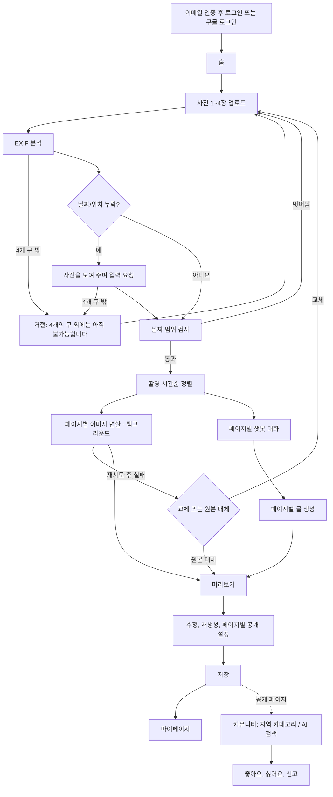
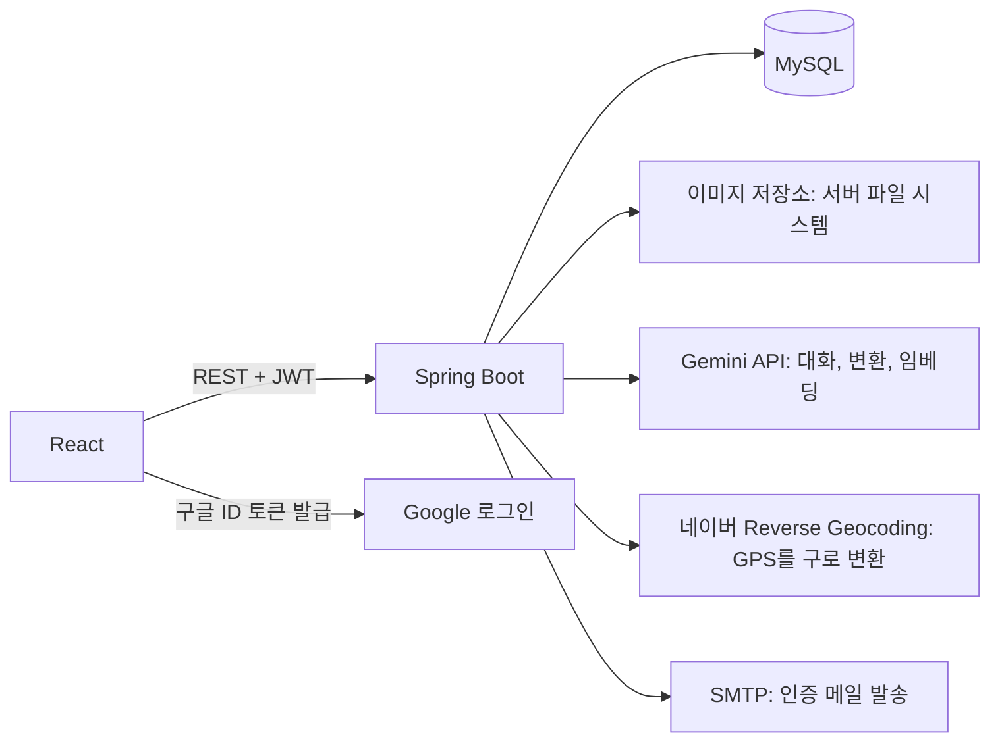

# AI 사진 일기: 제품 명세

사진을 올리면 AI가 애니메이션 그림체로 바꾸고, 사진마다 챗봇과 대화해 일기 페이지를 만든다. 공개한 페이지는 지역별 커뮤니티와 AI 검색으로 다른 사용자에게 보인다.

- API 계약: [api-spec.md](api-spec.md)
- DB 설계: [db-schema.md](db-schema.md)

## 용어

| 용어 | 정의 |
|---|---|
| 일기 (Diary) | 같은 논리 날짜의 페이지 1~4개 묶음 |
| 페이지 (Diary Page) | 사진 1장 + 글 1개. 공개, 지역, 좋아요, 신고의 단위 |
| 논리 날짜 | 오전 5시부터 다음 날 오전 5시 전까지를 하루로 보는 날짜 (한국 시간) |
| 변환 이미지 | AI가 애니메이션 그림체로 바꾼 이미지 |
| 원본 대체 | 변환 실패 시 변환 이미지 자리에 원본 사진을 넣는 것 |
| 공개 페이지 | 커뮤니티와 검색에 노출되는 페이지 ([노출 조건](#공개-규칙)) |

## 사용자 흐름

## 확정 규칙

### 업로드와 메타데이터

- 일기 한 편에 사진은 1~4장이다.
- 논리 날짜는 `촬영 시각 - 5시간`의 날짜다. 11월 7일 03:00 사진은 11월 6일 일기에 속한다.
- 한 일기의 모든 페이지는 논리 날짜가 같아야 한다. 벗어난 사진은 어떤 사진인지 알리고 교체하게 한다.
- 날짜가 없으면 사용자가 입력한다. 날짜를 입력한 페이지도 공개할 수 있다.
- 위치가 없으면 해당 사진을 보여 주며 "이 사진의 위치는 어디입니까?"라고 묻는다. 입력창과 **모르겠습니다** 버튼을 제공한다. 입력창에는 구 이름(`마포구`, `종로구`, `중구`, `강남구`)만 받고, 상호명이나 상세 주소는 받지 않는다. 기본값을 자동으로 채우지 않는다.
- **모르겠습니다**를 누르면 그 페이지는 공유할 수 없다고 안내하고 공유를 막는다.
- 사진 위치가 마포구, 종로구, 중구, 강남구 밖이면 일기를 만들 수 없다. EXIF 위치와 사용자 입력 모두 "4개의 구 외에는 아직 불가능합니다"라는 이유로 거절한다. 입력한 값이 4개 구 이름과 정확히 일치하지 않아도 같은 이유로 거절한다.
- EXIF GPS를 판정할 때는 시/도와 구를 함께 확인한다. 부산 중구처럼 이름만 같은 다른 지역을 서울 중구로 판정하지 않기 위해서다.

### 일기 페이지

- 페이지 하나는 변환 이미지 한 장과 글 하나로 구성된다.
- 글은 500자를 목표로 하고 800자를 넘을 수 없다. 사용자가 직접 수정할 때도 같은 상한을 적용한다.
- 원본 사진은 변환 실패 시 원본 대체를 고른 경우에만 페이지에 들어간다.

### 챗봇

- 대화는 페이지마다 따로 진행한다.
- 첫 질문은 사진을 분석해 어떤 행동을 했는지 유추해서 묻는다.
- 이후 질문은 그 사진에 대한 소감과 정보만 유동적으로 묻는다.
- 일기 분량이 500자쯤 되면 마무리를 안내하고, 800자에 도달하면 입력을 막고 글 생성으로 넘긴다.

### 이미지 변환

- 변환과 대화는 동시에 시작한다. 변환은 페이지별로 백그라운드에서 처리한다.
- 실패하면 자동으로 1회 재시도한다.
- 재시도까지 실패하면 문제 사진을 알린다. 사진을 교체해도 다른 페이지의 이미지와 대화는 유지하고, 교체한 페이지의 대화와 글만 초기화한다.
- 받은 이미지는 즉시 이미지 저장소에 파일로 저장하고, DB에는 경로만 남긴다.

### 공개 규칙

공개 범위는 두 단계로 설정한다.

| 단계 | 값 | 효과 |
|---|---|---|
| 일기 | `PRIVATE` | 전체 비공개. 페이지 설정과 무관하게 모두 숨긴다 |
| 일기 | `PUBLIC` | 페이지 설정을 따른다 |
| 페이지 | `PUBLIC` | 이미지와 글을 공개한다 |
| 페이지 | `PHOTO_HIDDEN` | 글만 공개한다 |
| 페이지 | `PRIVATE` | 이 페이지를 비공개한다 |

페이지는 아래 조건을 **모두** 만족할 때만 다른 사용자에게 보인다.

1. 일기 상태가 `COMPLETED`다.
2. 일기 공개 범위가 `PUBLIC`이다.
3. 페이지 공개 범위가 `PUBLIC` 또는 `PHOTO_HIDDEN`이다.
4. 신고로 차단되지 않았다.

### 커뮤니티

- 지역은 마포구, 종로구, 중구, 강남구 4개이며 구 단위로만 보여 준다.
- 카테고리를 고르면 해당 지역의 페이지만 보인다. 마포구 2장, 종로구 2장인 일기는 마포구에서 2장만 보인다.
- 다른 지역 페이지로 넘어가는 링크는 없다.
- 좋아요와 싫어요는 페이지별로 하나만 선택할 수 있다. 댓글 기능은 없다.
- 좋아요 수와 싫어요 수는 작성자를 포함해 어떤 사용자에게도 보여 주지 않는다. 사용자는 자신의 반응만 볼 수 있다.
- 페이지 점수는 `좋아요 수 - 싫어요 수`다.
- 목록은 날짜별로 묶지 않고 일기 점수가 높은 순으로 보여 준다. 일기 점수는 현재 카테고리에 표시되는 페이지 점수의 합이다. 점수가 같으면 최신 공개순이다.
- 한 일기 안의 페이지는 글의 흐름을 지키기 위해 촬영 시간순으로 보여 준다.

### AI 검색

- 검색어와 의미가 비슷한 공개 페이지를 찾아 목록으로 보여 준다. AI 답변 문장은 만들지 않는다.
- 지역 카테고리를 골랐으면 그 안에서만 찾는다.
- 유사도가 기준보다 낮은 페이지는 제외한다. 남은 결과가 없으면 "비슷한 일기가 없어요"를 보여 준다.
- 남은 결과는 유사도가 높은 순으로만 정렬한다. 좋아요와 싫어요는 검색 순서에 영향을 주지 않는다.

### 신고

- 같은 사용자는 같은 페이지를 한 번만 신고할 수 있다.
- 서로 다른 사용자의 신고가 3건 쌓이면 해당 페이지만 차단한다. 일기의 다른 페이지에는 영향이 없다.

### 마이페이지

- 저장한 일기를 논리 날짜 최신순으로 조회한다.
- 상세 보기, 글 수정, 공개 범위 변경, 삭제가 가능하다. 변경 내용은 커뮤니티와 검색에 바로 반영한다.

## 시스템 구성

| 기능 | 구현 |
|---|---|
| 인증 | Spring Security. 이메일 인증을 거친 비밀번호 로그인과 구글 로그인, 자체 JWT 발급 |
| 서비스 데이터 | MySQL |
| 이미지 | 파일은 서버 파일 시스템, 경로는 MySQL. Spring을 거쳐 서명 URL로만 제공 |
| 검색 | 임베딩을 MySQL에 저장하고 Spring에서 코사인 유사도를 계산 |
| EXIF GPS → 구 | 네이버 클라우드 Maps Reverse Geocoding |
| 사용자 입력 → 구 | 외부 API 없이 서버에서 4개 구 이름과 비교 |
| 인증 메일 | Spring Mail과 SMTP |

Gemini, 네이버, SMTP 키는 백엔드에만 둔다. Gemini 모델 이름은 코드에 고정하지 않고 환경 변수로 둔다.

## 확정된 구현 결정

| 항목 | 결정 |
|---|---|
| 변환 최종 실패 | **교체**와 **원본 대체** 중 사용자가 선택 |
| 위치 입력창 | 구 이름만 입력. 네이버 호출 없음 |
| 4개 구 밖의 사진 | 일기 생성 거절 |
| 데이터 저장소 | 서비스 데이터는 MySQL, 이미지 파일은 파일 시스템 또는 스토리지. Supabase 사용 안 함 |
| AI와 위치 판정 | Gemini API, 네이버 Reverse Geocoding |
| 커뮤니티 정렬 | 일기별로 묶어 일기 점수순 |
| 검색 정렬 | 유사도순 |
| 이메일 인증 | 비밀번호 가입 시 6자리 코드로 인증 |

## 그 밖의 가정

- 시간 입력은 선택이다. 시간이 없으면 입력한 날짜를 논리 날짜로 쓰고, 정렬 시 시간이 있는 페이지 뒤에 업로드 순서대로 둔다.
- 같은 사용자가 같은 날짜에 일기를 여러 편 만들 수 있다.
- 공개 범위의 초기값은 일기와 페이지 모두 `PRIVATE`다. 프론트엔드는 일기를 공개로 켤 때 공유 가능한 페이지를 `PUBLIC`으로 미리 선택해 보여 준다.
- 정확한 GPS 좌표는 저장하지 않는다. 지역만 구한 뒤 버리고, 사진 파일도 EXIF를 지운 뒤 저장한다.
- 신고로 차단된 페이지는 작성자가 다시 공개할 수 없다. 관리자 화면이 없으므로 해제 기능도 없다.
- 커뮤니티를 포함한 모든 API는 로그인이 필요하다.
- 글 생성에는 사용자 답변이 최소 1개 필요하다.
- 일기를 삭제하면 페이지, 대화, 반응, 신고, 이미지 파일을 함께 지우는 하드 삭제로 처리한다.
- 서버는 1대로 운영하고, 이미지 폴더는 재배포해도 사라지지 않는 디스크에 둔다. 서버를 늘리거나 디스크를 유지할 수 없으면 S3 호환 스토리지로 옮긴다. DB에는 상대 경로만 저장하므로 데이터 구조는 그대로 쓸 수 있다.
- 작성하다 버려진 초안의 자동 정리는 범위에서 제외한다.
- 비밀번호 찾기와 로그인 시도 제한은 범위에서 제외한다.
- EXIF에 GPS가 있어도 네이버 API 호출이 실패하면 거절하지 않고 위치 입력 화면으로 넘긴다.
- **모르겠습니다**를 누르면 4개 구 밖의 사진도 비공개 페이지로 넣을 수 있다.

## 이메일 인증

- 비밀번호로 가입하면 6자리 코드를 메일로 보낸다. 인증을 마치기 전에는 로그인할 수 없다.
- 코드는 10분 동안 유효하고 5번 틀리면 무효가 된다. 재발송은 60초에 한 번만 가능하며, 재발송하면 이전 코드는 무효가 된다.
- 미인증 이메일로 다시 가입하면 기존 미인증 계정의 비밀번호와 닉네임을 새 값으로 덮어쓰고 코드를 다시 보낸다. 다른 사람이 내 이메일로 먼저 가입해 두어도 실제 메일 주인이 가입할 수 있어야 하기 때문이다.
- 구글 로그인은 Google이 인증한 이메일(`email_verified`)만 받으며 별도 코드 인증은 없다.
- 같은 이메일의 계정이 이미 있으면 구글 계정을 연결한다. 그 계정이 미인증 상태였다면 비밀번호를 지운다. 메일 주인이 아닌 사람이 설정했을 수 있는 비밀번호이기 때문이다.

## 다음에 확인할 점

- 모바일 브라우저가 사진을 넘길 때 GPS를 지우는지 실제 기기에서 확인해야 한다. 지워진다면 대부분의 사진에서 위치 입력 화면이 나오므로 데모 흐름에 반영한다.
- 검색 시 공개 페이지의 임베딩을 모두 읽어 계산하므로 데이터가 많아지면 느려진다. 해커톤 규모에서는 문제가 없다.
